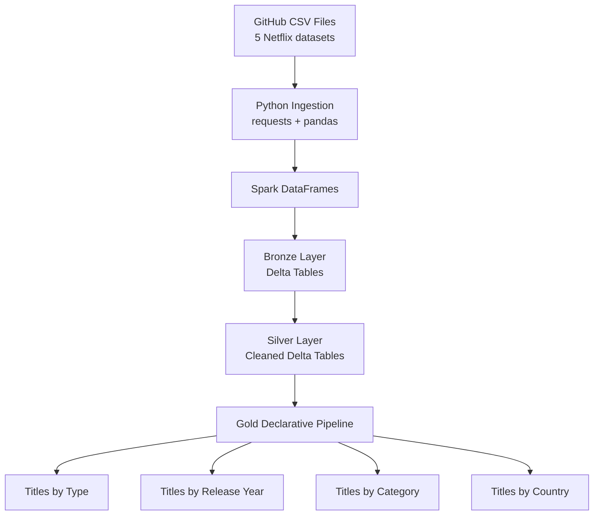

# Netflix Data Engineering Project

## Project Overview

This project demonstrates a data engineering workflow using Netflix titles data. It explores how raw CSV files can be ingested, cleaned, transformed, and prepared for analytical use through a Bronze, Silver, and Gold architecture.

The project uses Python, pandas, PySpark, Databricks, Delta Lake, Git, and GitHub.

The main objective is to build an understanding of data ingestion, data cleaning, layered data architecture, declarative pipelines, and analytical dataset creation.

## Project Objectives

* Ingest Netflix CSV datasets from GitHub into Databricks.
* Create Bronze-layer Delta tables from the source files.
* Clean and standardise the data to create Silver-layer tables.
* Build Gold-layer datasets for business analysis.
* Implement transformations using Python, PySpark, and Databricks declarative pipelines.
* Validate the resulting datasets using SQL.
* Maintain project code and documentation in GitHub.

## Technology Stack

| Technology              | Purpose                                              |
| ----------------------- | ---------------------------------------------------- |
| Python                  | Data ingestion and transformation logic              |
| pandas                  | Reading and preparing CSV data during ingestion      |
| PySpark                 | Distributed data transformation within Databricks    |
| Databricks Free Edition | Data processing and declarative pipelines            |
| Delta Lake              | Storage format for Bronze, Silver, and Gold datasets |
| SQL                     | Data validation and analytical queries               |
| VS Code                 | Local development and project organisation           |
| Git                     | Version control                                      |
| GitHub                  | Source-code repository and project documentation     |

## Architecture

The project follows the Medallion Architecture.




**Current implementation:** The CSV ingestion uses Python to retrieve files from GitHub, pandas to read the CSV content, and Spark to create DataFrames before writing Delta tables.

The Bronze and Silver tables are created through separate ingestion and transformation steps. The declarative pipeline currently manages the four Gold transformations.

The entire source-to-Gold workflow has not yet been automated as one orchestrated pipeline.

## Data Sources

The project uses five Netflix CSV datasets stored in the `RawData_AND_Notebooks` directory:

| File                    | Description                                 |
| ----------------------- | ------------------------------------------- |
| `netflix_titles.csv`    | Netflix title information                   |
| `netflix_cast.csv`      | Cast information associated with titles     |
| `netflix_category.csv`  | Category information associated with titles |
| `netflix_countries.csv` | Country information associated with titles  |
| `netflix_directors.csv` | Director information associated with titles |

Source repository:

[Azure Data Engineering Project on GitHub](https://github.com/Srisu108/Azure-Data-Engineering-project)

## Bronze Layer

The Bronze layer stores the ingested source data as Delta tables in Databricks.

The following tables were created:

* `netflix_titles_bronze`
* `netflix_cast_bronze`
* `netflix_category_bronze`
* `netflix_countries_bronze`
* `netflix_directors_bronze`

This layer provides the starting point for downstream data cleaning and transformation.

## Silver Layer

The Silver layer contains cleaned and standardised data.

The transformations include:

* Trimming text values.
* Converting duration fields to numeric types.
* Handling missing duration values according to the implemented transformation rules.
* Creating a title type flag.
* Deriving title-related fields.
* Standardising cast, category, country, and director text fields.
* Preserving title identifiers for relationships between datasets.

The Silver tables are:

* `netflix_titles_silver`
* `netflix_cast_silver`
* `netflix_category_silver`
* `netflix_countries_silver`
* `netflix_directors_silver`

The Silver exploration notebook is available at:

`silver/01_silver_data_exploration.ipynb`

Processed CSV outputs are stored in:

`silver/output/`

**Data quality note:** The source dataset contains some malformed or incomplete records. These records require further investigation and explicit data-quality rules before the project can be considered production-ready.

## Gold Layer

The Gold layer contains analytical datasets created from the Silver tables.

Four declarative pipeline transformations have been implemented and validated.

### 1. Titles by Type

**Output:** `netflix_titles_gold_by_type_pipeline`

Purpose:

* Count Movies and TV Shows.
* Calculate each type's percentage of the filtered catalogue.

Validated results:

| Type    | Total Titles | Percentage |
| ------- | -----------: | ---------: |
| Movie   |        4,265 |     68.42% |
| TV Show |        1,969 |     31.58% |

These figures exclude records whose type is not `Movie` or `TV Show`.

### 2. Titles by Release Year

**Output:** `netflix_titles_gold_by_year_pipeline`

Purpose:

* Group titles by release year.
* Count titles for each valid release year.

The current output contains 72 release-year groups, spanning 1925 to 2020.

The aggregation excludes null or out-of-range release years according to the implemented filter.

### 3. Titles by Category

**Output:** `netflix_categories_gold_pipeline`

Purpose:

* Count category assignments.
* Rank categories by their frequency.
* Return the top 20 categories.

The most frequent category in the validated results is International Movies, followed by Dramas and Comedies.

A title can belong to multiple categories, so category assignment counts should not be interpreted as mutually exclusive title counts.

### 4. Titles by Country

**Output:** `netflix_countries_gold_pipeline`

Purpose:

* Count distinct titles associated with each country.
* Support country-level comparisons and analysis.

Top results from the validated query:

| Country        | Distinct Titles |
| -------------- | --------------: |
| United States  |           2,609 |
| India          |             838 |
| United Kingdom |             601 |
| Canada         |             318 |
| France         |             271 |
| Japan          |             231 |
| Spain          |             178 |
| South Korea    |             162 |
| Germany        |             151 |
| Mexico         |             129 |

A title associated with multiple countries contributes to the count for each associated country. These counts do not represent exclusive production ownership.

## Declarative Pipeline

The Gold transformations are implemented using Python and the Databricks declarative pipeline API.

The four transformation files are:


RawData_AND_Notebooks/
└── transformations/
    ├── netflix_titles_gold_by_type.py
    ├── netflix_titles_gold_by_year.py
    ├── netflix_categories_gold_pipeline.py
    └── netflix_countries_gold_pipeline.py


Each transformation reads an existing Silver table, performs an aggregation, and defines a pipeline-managed output.

The pipeline was run successfully, and the Gold outputs were validated using SQL queries.

## SQL Validation

SQL was used to validate the analytical outputs and investigate the underlying data.

Validation included:

* Checking title counts by type.
* Checking the number of release-year groups and their range.
* Comparing category assignment counts.
* Comparing distinct title counts by country.
* Confirming that the pipeline outputs matched the expected analytical results.

## Repository Structure

The current project structure is organised as follows:

```text
Azure-Data-Engineering-project/
│
├── RawData_AND_Notebooks/
│   ├── netflix_cast.csv
│   ├── netflix_category.csv
│   ├── netflix_countries.csv
│   ├── netflix_directors.csv
│   ├── netflix_titles.csv
│   └── transformations/
│       ├── netflix_titles_gold_by_type.py
│       ├── netflix_titles_gold_by_year.py
│       ├── netflix_categories_gold_pipeline.py
│       └── netflix_countries_gold_pipeline.py
│
├── silver/
│   ├── 01_silver_data_exploration.ipynb
│   └── output/
│       ├── netflix_cast.csv
│       ├── netflix_category.csv
│       ├── netflix_countries.csv
│       ├── netflix_directors.csv
│       └── netflix_titles_silver.csv
│
└── README.md
```

The repository structure above describes the intended organisation of the files used in this project. Verify the listed output files against the current repository before publishing the final README.

## How to Reproduce the Project

### Prerequisites

* A GitHub account.
* Python and VS Code for local project work.
* A Databricks Free Edition workspace.
* Access to the source CSV files.

### Steps

1. Clone the GitHub repository.
2. Review the source CSV files and the Silver exploration notebook.
3. Open the Databricks workspace.
4. Ingest the source CSV files and create the Bronze Delta tables.
5. Run the Silver transformations to create the cleaned Delta tables.
6. Configure or open the declarative pipeline containing the four Gold transformations.
7. Run the pipeline update.
8. Validate the resulting Gold outputs using Databricks SQL.

The Gold transformations depend on the Silver Delta tables being available in the Databricks workspace. The local Python files alone do not create those tables.

## Limitations

* Source ingestion currently uses Python, requests, and pandas rather than Auto Loader.
* The complete source-to-Gold workflow is not yet orchestrated as one automated pipeline.
* Some malformed or incomplete source records require additional data-quality rules.
* The Gold datasets are analytical aggregations rather than a complete dimensional data warehouse.
* Power BI integration and dashboard development are not included in the current implementation.
* The project has been developed in Databricks Free Edition, so the implementation should not be described as a fully deployed Azure production solution.

## Future Improvements

* Add explicit data-quality checks and exception handling.
* Automate the ingestion, Bronze, Silver, and Gold stages.
* Investigate incremental ingestion and schema evolution.
* Add reproducible setup instructions and pipeline configuration.
* Develop Power BI dashboards using the Gold outputs.
* Improve pipeline monitoring, testing, and documentation.

## Author

Project repository:

[Azure-Data-Engineering-project](https://github.com/Srisu108/Azure-Data-Engineering-project)


